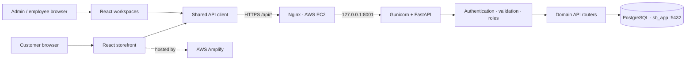
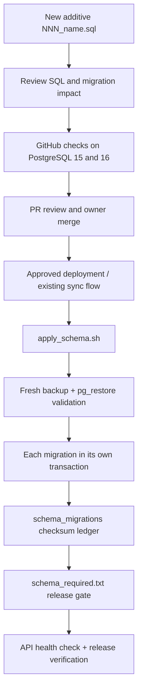
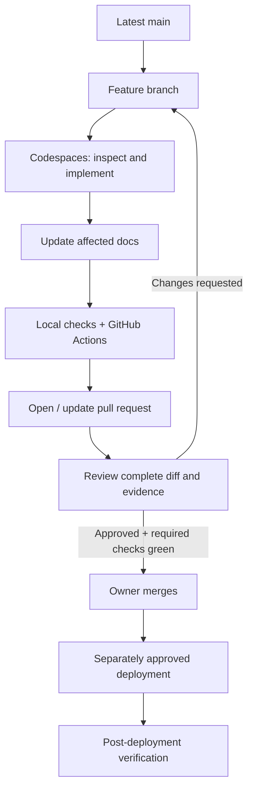

# Super Bajaar

> **Project handbook · Architecture · Engineering standards · Operations**

Super Bajaar is a commerce storefront and ERP platform. This README is the **front door and project index**: it gives the verified project overview, architecture at a glance, operating tools, critical safety rules, current status and links to the detailed source-of-truth documents.

> [!CAUTION]
> **Production safety comes first.** Never reset, drop, truncate, recreate or bulk-delete production data. Never change the established hosting, services, ports, API prefix, deployment mechanism or production secrets without explicit owner approval and a verified plan.

> [!WARNING]
> A code change, registered route, green CI run or successful frontend build does **not** prove a complete production workflow. Verify the full UI → API → permission/business rule → PostgreSQL → response path. CI uses disposable databases; it does not certify production.

> [!IMPORTANT]
> Work from a feature branch created from the latest `main`. Never push directly to `main`. Every material change must update its relevant documentation in the same PR. The owner controls merge and production release approval.

---

## 🔴 Latest project update

**Documentation governance consolidation — PR [#170](https://github.com/siinghniibandhan-wq/superbajaar/pull/170)**

- Consolidates overlapping database design, release-gate and API reference documents.
- Expands the evidence-based audit framework.
- This PR is open for review; do not treat its contents as merged or deployed until GitHub confirms that state.
- This follow-on update adds the project tool register, diagnostic decision guide, GitHub/PR lifecycle and schema automation runbook to the same PR.

## 🚨 Critical findings and release status

| Area | Current documented position | Evidence boundary |
|---|---|---|
| Production database and live migration ledger | **Not verified by this documentation work** | Requires owner-approved read-only preflight |
| Production backup readiness | **Not verified here** | Must be checked on the production host before a migration |
| Production deployment / live checkout | **Not verified here** | Requires separately approved release and post-deploy checks |
| API and business workflows | Source-level contracts are documented; runtime coverage must be verified | Route presence is not end-to-end proof |
| CI | Check the linked PR's live Actions status | Only the exact commit and completed checks count |

**Finding discipline:** Only put confirmed unresolved issues in this section. Each critical/high finding must have evidence, impact, owner and next action. Move resolved or superseded items to `IMPORTANT_UPDATES.md`.

---

## 1. Project at a glance

| Layer | Current design |
|---|---|
| Web application | React + Vite |
| Frontend hosting | AWS Amplify |
| Backend API | Python FastAPI |
| Backend hosting | AWS EC2 |
| Reverse proxy / application server | Nginx + Gunicorn |
| Backend listener | `127.0.0.1:8001` |
| Database | PostgreSQL, database `sb_app`, port `5432` |
| Public API prefix | `/api` |
| Source control / CI | GitHub repository and GitHub Actions |
| Mobile-first development workflow | GitHub + Codex/Jules/Copilot cloud-agent workflows; Codespaces optional when computer access is available |
| API contract and interactive checks | FastAPI Swagger / OpenAPI |
| Schema change mechanism | Versioned SQL + `apply_schema.sh` + `schema_required.txt` + migration ledger |
| Backend operations | Existing systemd service/timer and approved AWS operations |

### Product areas

Catalogue, attributes and variants; pricing and promotions; inventory; purchasing; orders; payments; delivery/logistics; customers and CRM; loyalty; POS; accounting and tax; HR and payroll; reporting and administration.

The presence of a module in this list describes the product scope, not a claim that every workflow is complete or production-ready. Check the implementation and progress evidence before planning a release.

---

## 2. System architecture

**Request path:** Browser UI → shared frontend API client → HTTPS `/api/*` → Nginx → Gunicorn/FastAPI on port 8001 → authentication/authorization and business validation → PostgreSQL → JSON response → UI.

The browser is never authoritative for prices, tax, stock, permissions or order totals. The backend must validate and calculate these values.

See [Architecture and API contracts](docs/architecture.md) for detailed diagrams, domain boundaries, request lifecycle, route contracts and known limitations.

---

## 3. Technology and tool register

| Tool / service | Why it exists | Primary use | Use it when |
|---|---|---|---|
| **GitHub** | Source of truth and controlled collaboration | Repository, branches, commits, PRs, reviews, Actions | Every code/document change and release review |
| **GitHub Codespaces** | Optional computer-based development workspace | Inspect/edit code, run backend tests, frontend builds, linters and local diagnostics when available | Not required for the current mobile-first workflow |
| **Swagger / OpenAPI** | Live API contract and interactive endpoint explorer | Inspect schemas, auth, parameters, responses and test requests | First stop for API/endpoint/request-response defects |
| **ChatGPT** | Technical leadership and work coordination | Architecture reasoning, task planning, code review, debugging, documentation and evidence review | Plan and coordinate work; never treat an unexecuted suggestion as a test result |
| **Claude** | Designated database/schema implementation reviewer and default SQL/runner author under current governance | Scoped SQL, migration runner and schema workflow work | Database-impacting changes, following `CLAUDE.md` and owner approval |
| **GitHub Copilot** | Additional AI coding assistant | Code completion, explanations, bounded implementation, test suggestions and first-pass review where plan features permit | Feature branches only; follow `AGENTS.md` and [Copilot usage policy](docs/GITHUB_COPILOT.md); never bypass review, CI, schema governance or owner approval |
| **AWS EC2** | Hosts backend runtime | Inspect services, process state, logs, networking, environment and host health | Only when evidence points to runtime, server or infrastructure |
| **AWS Systems Manager Run Command** | Controlled remote EC2 command execution | Approved operational commands and read-only checks | When remote server inspection/action is necessary and authorized |
| **AWS Amplify** | Frontend hosting and build/deployment | Build logs, hosting status, deployed frontend | Frontend build or hosting/deployment investigation |
| **PostgreSQL** | Persistent application data | Schema, records, constraints, transactions and migration ledger | Database behaviour and integrity investigation; production writes require approval |
| **Nginx** | HTTPS reverse proxy | Host routing and forwarding to backend | Proxy, TLS, upstream and routing symptoms |
| **Gunicorn + FastAPI** | Serves backend API | Application process, route registration and API runtime | Backend/API runtime investigation |
| **systemd service/timer** | Existing backend process and synchronization operations | Service state, timer schedule and logs | Evidence indicates service or scheduled sync issue |
| **GitHub Actions** | Automated quality gates | Backend tests, frontend builds, PostgreSQL 15/16 migration checks | Every PR and relevant CI failure |

This is the documented core toolchain. A tool is not considered active merely because it was discussed or evaluated; integrations and deployment triggers must be confirmed in source/configuration before being added as active dependencies.

Detailed usage, diagnostic order and decision matrix: [Development, GitHub and operations workflow](docs/DEVELOPMENT_WORKFLOW.md).

AI contributor roles, file ownership, 2–3-file work batches and cross-agent handoffs: [AI Team Collaboration & Delivery Policy](docs/AI_TEAM_COLLABORATION.md).

Tool priorities, MUST KEEP primary tools, KEEP fallbacks, free-quota switching and mobile-first operating rules: [Free-First Tool Utilisation & Role Assignment Policy](docs/TOOL_UTILISATION_POLICY.md).

---

## 4. Database and schema automation

**The schema runner is a core release mechanism. It is not an optional manual SQL step.**

Key files:

| File | Purpose |
|---|---|
| `backend/schema/*.sql` | Versioned SQL migrations |
| `backend/scripts/apply_schema.sh` | Safe runner: status/dry-run/retry, backup, transactions, checksums, failure handling and exit codes |
| `backend/schema_required.txt` | Schema files required by the application release |
| `backend/scripts/tests/test_apply_schema.sh` | Migration-runner behaviour tests |
| `.github/workflows/migration-check.yml` | Disposable PostgreSQL 15/16 checks, repeat-application and runner tests |
| `schema_migrations` | Applied filename/checksum ledger in the target database |
| `schema_migration_failures` | Failure records written by the runner |

**Runner contract:** backup failure means no migration is applied; each file runs in its own transaction; applied-file checksum changes are reported and never silently re-applied; failed files are recorded; required files determine whether a release may proceed. Exit codes and exact behaviour are documented in [Database change and release rules](docs/DATABASE_CHANGE_RULES.md).

**Never infer production schema state from Git.** The live ledger, file checksums, target database and backup readiness must be checked by the owner before an approved production migration. Do not edit, rename, delete or reformat previously applied migrations. Add only a properly numbered, additive, idempotent migration under the approved one-file rule.

---

## 5. Development and GitHub flow

- Branch from the latest `main`; never push directly to `main`.
- One PR should have a clear purpose, owner, scope, acceptance criteria and test evidence.
- Update relevant documentation in the same PR; explain any “no documentation change” decision.
- Required CI must pass on the exact commit; inspect the full diff before merge.
- The repository owner retains merge and production-release authority.
- Normal operating limit: **15 open PRs**. Target resolution: **5 calendar days**; review/escalation at Day 7; target closure by Day 10. Resolve by merging or closing with a reason. Do not merge unsafe work or close valid work merely to satisfy a metric. Urgent security/production fixes may exceed the cap with owner visibility.
- These are documented team operating targets; GitHub will not enforce the count or age unless a separate automation/ruleset is configured.

See [Development, GitHub and operations workflow](docs/DEVELOPMENT_WORKFLOW.md) and [.github/pull_request_template.md](.github/pull_request_template.md).

---

## 6. Where to investigate when something goes wrong

| Symptom / evidence | Start here | Next step | Do not do this first |
|---|---|---|---|
| Page layout, React state, browser console or form issue | Codespaces + browser dev tools | Inspect component, route, API client and reproduce | Do not restart EC2 without runtime evidence |
| API route missing, wrong payload, validation or status code | Swagger / OpenAPI | Inspect route, schema, auth and response; then Codespaces | Do not jump straight to AWS |
| API returns 401/403 | Swagger + auth contract | Inspect token, session, role and middleware | Do not weaken permissions to make a test pass |
| API returns 404/422/500 | Swagger first | Check route registration, payload, validation, traceback and DB dependency | Do not assume every 500 is an AWS issue |
| Database column/table/constraint error | Codespaces + schema files + required manifest | Compare SQL, application query and migration ledger evidence | Do not manually alter production schema |
| Migration CI failure | GitHub Actions | Read failing step, reproduce on disposable PostgreSQL 15/16 | Do not test against production |
| Backend service/process/log/network issue | AWS EC2 / SSM Run Command | Inspect systemd, Gunicorn, Nginx, logs and port 8001 | Do not edit deployment config speculatively |
| Frontend build or hosted page issue | GitHub Actions + AWS Amplify | Inspect build artifact/logs and deployment state | Do not change backend or DB without evidence |
| Scheduled sync/timer issue | AWS EC2 / systemd | Inspect timer, service and execution logs | Do not replace the timer or change cadence casually |
| Production data/ledger mismatch | Owner-only DB preflight | Read-only ledger/checksum and backup verification | Never run destructive SQL or manually fake ledger entries |

**Diagnostic priority:** GitHub → Codespaces/source → Swagger/OpenAPI for API issues → CI → AWS only when evidence requires it → Amplify for frontend hosting → post-deployment checks. A genuine outage/security incident can justify immediate infrastructure checks.

---

## 7. Fixed production constraints

| Component | Required target |
|---|---|
| Backend listener | `127.0.0.1:8001` |
| PostgreSQL | `5432` |
| Production database | `sb_app` |
| API prefix | `/api` |
| Frontend | Existing AWS Amplify application |
| Backend host | Existing AWS EC2 |
| Proxy / app server | Existing Nginx + Gunicorn |
| Process automation | Existing systemd service/timer |

Do not create a replacement server, database, service, deployment target or hosting platform without explicit approval. Do not expose credentials, tokens, connection strings or `.env` values in commits, logs, screenshots or chat.

---

## 8. Documentation directory — each file has one job

| File | Its specific responsibility | Update it when |
|---|---|---|
| `README.md` | Main handbook, overview, current status, tool register and navigation | Project-wide facts, critical status or top-level architecture changes |
| `AGENTS.md` | Shared mandatory instructions for all AI coding agents | Contributor-wide rules or mandatory reading rules change |
| `CLAUDE.md` | Claude-specific database/SQL/runner responsibilities | Database authorship or reviewer responsibilities change |
| `IMPORTANT_UPDATES.md` | Concise chronological record of major decisions and releases | A material change is merged or a significant verified status changes |
| `docs/architecture.md` | Technical architecture, domain boundaries, API contracts and data flow | UI, API, service, integration or architecture changes |
| `docs/DATABASE_CHANGE_RULES.md` | Database governance, migration runner, schema safety and release preflight | Schema, runner, database permissions or release procedure changes |
| `docs/DEVELOPMENT_WORKFLOW.md` | Tool register, diagnostic order, GitHub/PR lifecycle and operational decision guide | Tooling, development workflow, GitHub process or diagnostic ownership changes |
| `docs/PROJECT_PROGRESS_STRUCTURE.md` | Work breakdown, audit categories, status vocabulary and reporting template | Progress or audit framework changes |
| `.github/pull_request_template.md` | Required PR scope, tests, documentation and release checklist | PR acceptance requirements change |
| `backend/schema_required.txt` | Exact migrations required by current application code | Code starts depending on a new schema migration (database owner process) |

Do not create duplicate documents for a topic that already has a clear canonical home. The README links to detailed instructions rather than copying every rule.

---

## 9. Required reading before work

All contributors and AI agents must read `README.md` and `AGENTS.md` first. Then read the canonical document for the task:

| Task | Required detailed reading |
|---|---|
| New page / frontend feature | `docs/architecture.md`, `docs/DEVELOPMENT_WORKFLOW.md` |
| New or changed API | `docs/architecture.md`, `docs/DEVELOPMENT_WORKFLOW.md` |
| Backend business logic | `docs/architecture.md` |
| Architecture / domain boundary | `docs/architecture.md`, `docs/PROJECT_PROGRESS_STRUCTURE.md` |
| Database / SQL / migration / data | `docs/DATABASE_CHANGE_RULES.md`, `CLAUDE.md` and owner approval rules |
| Security / access control | `docs/architecture.md`; database rules if data/schema is involved |
| AWS / deployment / hosting | `docs/DEVELOPMENT_WORKFLOW.md`, `docs/DATABASE_CHANGE_RULES.md` if migration is involved |
| Audit / project reporting | `docs/PROJECT_PROGRESS_STRUCTURE.md` and the relevant technical source |
| Major project-wide change | `IMPORTANT_UPDATES.md` and the relevant canonical technical document |

The full mandatory reading and documentation-update matrix is in [AGENTS.md](AGENTS.md).

---

## 10. Quality, audit and definition of done

A task is not “done” merely because code was written.

1. Scope and acceptance criteria are clear.
2. Existing implementation and canonical documentation were inspected.
3. Code and tests are updated without unrelated changes.
4. Relevant docs and dated change record are updated.
5. Backend tests, frontend builds, schema checks and contract checks pass where applicable.
6. PR diff and CI evidence are reviewed.
7. Owner merges the PR.
8. Deployment is separately approved.
9. Post-deployment health and relevant end-to-end flows are verified.
10. Progress and release evidence are recorded.

Use [Project progress and audit structure](docs/PROJECT_PROGRESS_STRUCTURE.md) for the required work breakdown, severity, evidence and status vocabulary.

---

## 11. Key repository references

- [Architecture and API contracts](docs/architecture.md)
- [Database change and release rules](docs/DATABASE_CHANGE_RULES.md)
- [Development, GitHub and operations workflow](docs/DEVELOPMENT_WORKFLOW.md)
- [Project progress and audit framework](docs/PROJECT_PROGRESS_STRUCTURE.md)
- [AI agent instructions](AGENTS.md)
- [Claude instructions](CLAUDE.md)
- [Important updates / change history](IMPORTANT_UPDATES.md)
- [Pull request template](.github/pull_request_template.md)
- [Migration CI workflow](.github/workflows/migration-check.yml)
- [General CI workflow](.github/workflows/ci.yml)

**Document control:** This README is the project overview. Detailed procedures live in the linked canonical documents. Keep facts consistent, dated and evidence-backed.
