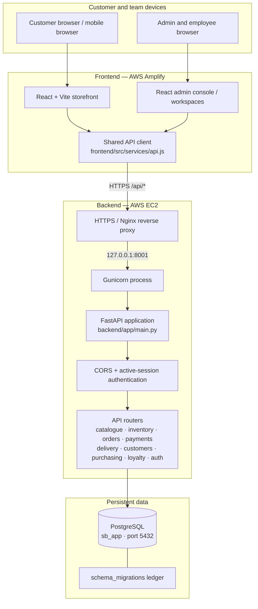
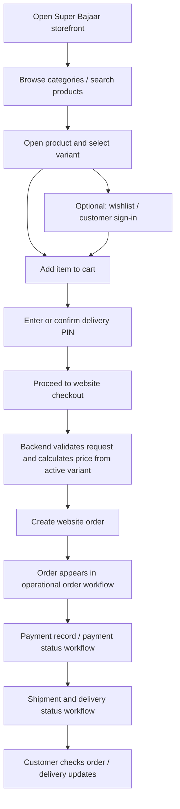
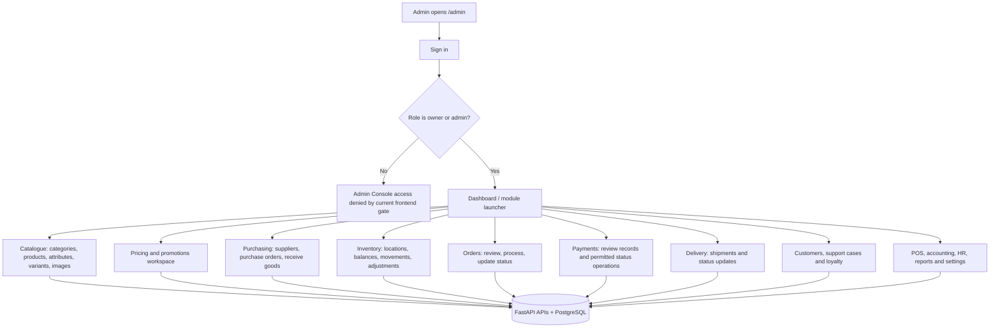
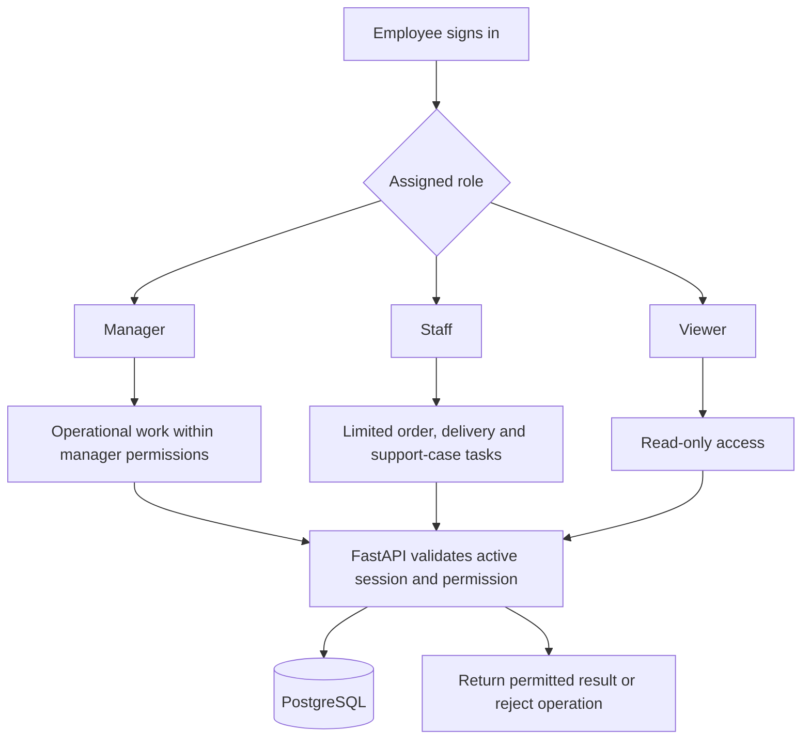

# Super Bajaar

Super Bajaar is a commerce storefront and ERP application. This file is the single project guide: it explains the current structure, what each important file does, how requests flow, and how the application is deployed.

## PRECAUTIONS AND STRICTLY PROHIBITED CHANGES

This section is a mandatory safety checklist for every contributor and coding agent. A change that conflicts with these rules must stop for explicit approval; do not improvise, “clean up,” reset, replace, or bypass existing infrastructure.

### Runtime, ports, database and services — do not change casually

- Backend must continue to listen on **port `8001`**. Do not move it to `8000` or another port.
- PostgreSQL must continue to listen on **port `5432`**. Do not change the port or replace PostgreSQL with another database.
- Production database name is **`sb_app`** (verify the target before any database operation; never create a substitute database to avoid a connection problem).
- Preserve the existing **Gunicorn** backend process, its current bind address/port, and the existing **systemd service and timer** used for backend operation/code synchronization. Do not replace, rename, disable, or bypass these services or change their cadence without explicit approval.
- Preserve the existing **Nginx** reverse-proxy configuration and routing to the backend on `127.0.0.1:8001`. Do not change upstreams, proxy routes, TLS, or host configuration as a workaround without approval.
- Preserve the existing **AWS EC2 backend** and **AWS Amplify frontend** deployment arrangement. Do not create a new server, service, deployment target, database, or hosting platform without approval.
- Preserve the existing automatic deployment/synchronization mechanisms, repository/branch settings, build settings, environment-variable names, and deployment hooks. Do not disable, replace, or trigger production deployment merely to test a change. Confirm the exact workflow before editing deployment configuration.
- Keep the existing public API prefix `/api`, CORS/security configuration, authentication/session behaviour, and established frontend-to-backend URL contract unless a verified requirement and explicit approval authorize a change.
- Never print, commit, rotate, overwrite, or remove production secrets or environment values as part of unrelated work. Never put credentials in README or source code.

### Schema files and migration rules — strictly prohibited

- **Never edit, delete, rename, replace, regenerate, or reformat `backend/schema/000_baseline_schema.sql`.**
- **Never edit, delete, rename, replace, regenerate, or reformat `backend/schema/009_loyalty_programme.sql`.**
- Do not edit, delete, rename, reorder, or reapply `backend/schema/009_product_availability_delivery.sql` as a quick fix. It shares the `009` prefix with the protected loyalty migration; its production application status and migration-runner ordering must be verified first.
- Never edit or delete any existing migration that may already have been applied. Inspect all schema files and the target database's `schema_migrations` records before choosing the next unused migration number.
- If a schema change is truly necessary, create a separate additive, idempotent migration using the existing approved workflow. Follow the project’s one-new-schema-file rule; do not bundle unrelated schema changes.
- Never run `DROP TABLE`, `DROP SCHEMA`, `TRUNCATE`, destructive reset scripts, database recreation, or bulk-delete statements against production. Never assume a table is disposable because it is empty or absent from this README.
- Treat **all existing production tables, records, sequences, indexes, constraints, triggers, grants, and migration history as protected**. This includes, wherever present, products, categories, attributes, variants, product images, customers, users, user sessions, orders, payments, stock locations/balances/movements, suppliers/purchasing, deliveries/shipments, loyalty data, and `schema_migrations`.
- Do not change table ownership, database roles/permissions, or production data without an explicitly approved, verified migration plan and backup.
- A schema file being present in Git does not prove it has or has not been applied in AWS. Check the live migration ledger and database state before any decision that depends on application status.

### Source control, coding and verification — strictly required

- **Switch to the intended working branch first.** If branch switching fails, stop; do not pull, edit, build, test, or commit on the wrong branch.
- Create work branches from the current `main`; never push directly to `main`. Use a pull request and review its complete diff before merging.
- Do not overwrite or revert unrelated working code. Keep changes minimal and within the approved scope.
- Never claim a build, test, endpoint, database integration, or deployment passed unless it was actually executed and the result was observed. Distinguish local/Codespaces checks from live AWS verification.
- Before merging backend/schema changes, verify the frontend build, backend tests, route registration, migration compatibility, and relevant API/database behaviour. Do not deploy merely because unit tests pass.
- Do not run production migrations or deploy automatically as part of documentation or routine code changes.
- If any instruction in this section conflicts with a proposed change, stop and ask for approval rather than proceeding.

## Fixed technology and runtime

- Frontend: React + Vite, hosted on AWS Amplify.
- Backend: FastAPI on AWS EC2, behind the existing Nginx configuration.
- Database: PostgreSQL.
- Backend port: `8001` (keep unchanged).
- PostgreSQL port: `5432` (keep unchanged).
- Frontend development port: `5173` (existing Vite configuration).
- API prefix: `/api` (the only public API prefix).
- Do not add ports, services, databases, or deployment targets without an identified need and approval.
- Never reset or clear production data as part of routine development.

## Main request flow

1. A page or form in the frontend calls the shared frontend API client.
2. The API client sends an HTTP request to the backend URL with the required authentication token.
3. A route in `backend/app/api/` receives and validates the request.
4. Backend code applies the relevant business rules and checks permissions.
5. PostgreSQL is read or updated using the existing database connection/query code.
6. The backend returns a response; the frontend displays the result or error.

There must be one authoritative backend API system. Frontend API functions are callers, not a second backend. Frontend values must not be trusted for authoritative prices, tax, stock, permissions, or order totals.

## Frontend file map

- `frontend/package.json`: frontend dependencies and build scripts.
- `frontend/index.html`: Vite HTML entry.
- `frontend/vite.config.js`: Vite configuration; existing development port is `5173`, preview configuration is `4173`. Do not change these casually.
- `frontend/src/main.jsx`: React entry point.
- `frontend/src/app/`: application shell and routing.
- `frontend/src/pages/`: page-level UI.
- `frontend/src/features/`: feature/module-specific UI and workflows.
- `frontend/src/components/`: reusable UI components.
- `frontend/src/layouts/`: shared page layouts.
- `frontend/src/services/api.js`: shared frontend API request function, base URL, auth token header, response and error handling.
- `frontend/.env.example`: example frontend environment configuration. Production API URL must match the deployed backend; do not commit secrets.

## Backend file map

- `backend/requirements.txt`: Python dependencies.
- `backend/app/main.py`: creates the FastAPI application, middleware and registers routers.
- `backend/app/core/config.py`: environment-based settings, API prefix, CORS configuration and backend port setting.
- `backend/app/core/auth_middleware.py`: active-session/authentication middleware.
- `backend/app/api/auth.py`: authentication endpoints.
- `backend/app/api/catalogue.py`: catalogue, categories, product attributes and variants endpoints.
- `backend/app/api/inventory.py`: inventory endpoints.
- `backend/app/api/purchasing.py`: purchasing endpoints.
- `backend/app/api/orders.py`: order endpoints.
- `backend/app/api/payments.py`: payment endpoints.
- `backend/app/api/delivery.py`: delivery endpoints.
- `backend/app/api/customers.py`: customer endpoints.
- `backend/app/api/health.py`: health endpoint.
- `backend/tests/`: backend tests.

The route files on the current codebase include some direct database access. A separate service/repository layer is not assumed to exist everywhere. Extract code only when a verified fix or maintenance need justifies it; do not rewrite working modules just to match a folder pattern.

## Backend API endpoints currently registered

All paths below are prefixed with `/api` by `backend/app/main.py`. This list is based on route declarations in the repository, not a claim that production/database integration has been runtime-tested.

- Health: `GET /health`
- Authentication: `POST /auth/login`, `GET /auth/me`, `POST /auth/logout`
- Catalogue: `GET/POST /catalogue/categories`, `GET/POST /catalogue/products`, `GET /catalogue/attributes`, `POST /catalogue/attributes`, `GET /catalogue/products/{product_id}/attributes`, `PUT /catalogue/products/{product_id}/attributes/{attribute_id}`, `GET/POST /catalogue/products/{product_id}/variants`, `GET/POST /catalogue/products/{product_id}/images`, `GET /catalogue/variants`, `PUT /catalogue/variants/{variant_id}/price`
- Inventory: `GET/POST /inventory/locations`, `GET /inventory/balances`, `GET /inventory/movements`, `POST /inventory/adjustments`
- Orders: `GET/POST /orders`, `GET /orders/summary`, `GET /orders/{order_id}`, `PATCH /orders/{order_id}/status`
- Payments: `GET/POST /payments`, `PATCH /payments/{payment_id}/status`
- Delivery: `GET/POST /delivery/shipments`, `PATCH /delivery/shipments/{shipment_id}/status`
- Customers and support: `GET/POST /customers`, `PATCH /customers/{customer_id}`, `GET/POST /customers/support-cases`, `PATCH /customers/support-cases/{case_id}`
- Purchasing: `GET/POST /purchasing/suppliers`, `GET/POST /purchasing/orders`, `GET /purchasing/orders/{purchase_id}`, `POST /purchasing/orders/{purchase_id}/receive`

Route existence does not prove that a screen works end to end. For each workspace, check the actual request payload, response fields, authentication and database schema. A missing operation must be implemented against the existing schema and tested; do not invent a second API or change ports to work around it.

## Database and schema

- PostgreSQL is the production database; do not switch to SQLite.
- `backend/schema/`: versioned SQL schema changes used by the current project workflow.
- `database/`: existing database-related assets; inspect their actual usage before changing them.
- Use parameterised queries and transactions where required.
- Schema changes must be reviewed, idempotent where appropriate, and applied through the existing safe migration workflow.
- Never run destructive reset, drop, or truncate operations against production.
- Do not put database credentials or other secrets in source control.

### Schema file inventory and protected files (observed on main)

**Do not edit, delete, rename, replace, or regenerate these protected files:**

- `backend/schema/000_baseline_schema.sql` — protected baseline schema; never modify or delete.
- `backend/schema/009_loyalty_programme.sql` — protected applied migration; never modify or delete.

Treat these as explicit handbook rules, not suggestions. Any future schema change must be added as a new migration file; do not amend an existing/applied migration. Check the full directory and migration history before selecting the next unused migration number. The current repository already contains `010_customer_accounts_referrals.sql` and `011_customer_phone_uniqueness.sql`; do not assume `010` is available.
- `backend/schema/009_product_availability_delivery.sql` — product POS/website availability, delivery options and availability-rule table.
- `backend/schema/010_customer_accounts_referrals.sql` — customer accounts/referrals changes.
- `backend/schema/011_customer_phone_uniqueness.sql` — customer phone uniqueness change.

**Important: two migration files currently use the `009` prefix:** `009_loyalty_programme.sql` (protected) and `009_product_availability_delivery.sql` (added by PR #138). Do not rename, delete, reorder, or edit either file as a quick fix. Before applying any migration in a live environment, inspect the schema runner's ordering and the production `schema_migrations` records to confirm both files are handled safely. Do not apply or reapply the product availability migration until its live application status and ordering are confirmed.

### Data and table preservation — mandatory

- Treat **every existing production table and all its data as protected**. The examples below are not an exhaustive table inventory.
- Never drop, truncate, recreate, rename, or clear an existing table as part of feature work or a schema reset.
- Core business tables that must be preserved include products, categories, product attributes, product variants, product images, customers, orders, payments, inventory/stock locations and balances, purchasing/suppliers, deliveries/shipments, users, user sessions, and loyalty data wherever those tables exist in the active schema.
- The availability migration adds columns to `public.products` and creates `public.product_availability_rules`; it must not replace or recreate `products`.
- Before any schema change, compare the migration against existing schema files and the actual database. Use additive, idempotent migrations where appropriate; take a verified backup and use the approved schema runner.
- Do not assume this README is a live inventory of production tables. Confirm actual table names and migration history against the target database before making changes.

## Business modules to preserve

Storefront, product catalogue, categories, attributes, variants, pricing/GST, customers, authentication/permissions, inventory/warehouses, purchasing/vendors, orders, payments/refunds, delivery, POS, accounting/tax, loyalty, HR/payroll, and reporting.

A module is not considered functional merely because its page or route exists. Verify the UI → API request → backend behaviour → PostgreSQL operation → response flow.

## Deployment and verification rules

- Keep the existing AWS Amplify, EC2, Nginx and PostgreSQL setup.
- Keep backend port `8001` and PostgreSQL port `5432`.
- Keep `/api` as the single public API prefix. Do not introduce API version segments.
- Test on a branch created from `main`; do not push directly to `main`.
- Before changing an endpoint, check both its frontend caller and backend route, including request/response field names and authentication requirements.
- Before changing schema, check existing schema files and production compatibility.
- Report only checks actually run and distinguish local tests from live AWS verification.

## Database safety and release process

Super Bajaar uses a repository-based database migration runner, automated checks, and GitHub branch protection to reduce the risk of accidental schema changes and unverified releases.

### What is in place

- **Safe migration runner:** `backend/scripts/apply_schema.sh` supports dry-run and status modes, checks the migration ledger and file checksums, takes and validates a backup before applying changes, and runs each migration in its own transaction.
- **Failure handling:** failed or changed migrations are reported and recorded. The runner uses exit codes to distinguish safe completion, non-required failures, missing required schema, backup failures, and setup/concurrency problems.
- **Baseline protection:** an unrecorded `000_baseline_schema.sql` is refused when the database already contains user objects. The baseline is intended only for a genuinely empty-database bootstrap.
- **Least-privilege database access:** the runner does not grant blanket permissions across all tables or sequences. A migration must declare only the specific permissions required for the objects it creates.
- **Legacy migration filename protection:** automated validation preserves the four existing legacy files using the `009` and `012` prefixes and rejects additional reuse of those numbers.
- **Automated PostgreSQL compatibility checks:** the GitHub Actions workflow `.github/workflows/migration-check.yml` tests the schema and migration runner on disposable PostgreSQL 15 and 16 databases. It applies the schema files twice and runs the runner test suite.
- **Protected main branch:** the active GitHub ruleset `Protect main` requires pull requests, successful `database-files (15)` and `database-files (16)` checks, and an up-to-date branch. It also blocks force pushes and deletion of the default branch.

### Required workflow for future changes

1. Create a feature branch from the latest `main`; do not push directly to `main`.
2. Read `docs/DATABASE_CHANGE_RULES.md` before any database, schema, migration, data, backup, or deployment work.
3. Keep existing/applied schema files unchanged. Use the approved additive migration process for necessary schema changes, and update `backend/schema_required.txt` when application code requires a new schema file.
4. Open a pull request with the project template. Review the complete diff and wait for required checks to pass.
5. Keep the PR branch up to date with `main`. Merge only through the protected pull-request workflow.
6. Before a production deployment or migration, complete the read-only checks in `docs/RELEASE_GATES.md`, inspect the live migration ledger/checksums, and confirm backup readiness. Production migration/deployment is a separate owner-approved action.

### What these checks do not prove

Successful CI checks prove the tested code and schema passed on disposable PostgreSQL 15 and 16 environments. They do **not** connect to or validate the production database, inspect its live migration ledger or data, create a production backup, prove every application workflow works, or authorize a production deployment. Those checks remain separate release responsibilities.

### Detailed documentation

- [Database change rules](docs/DATABASE_CHANGE_RULES.md)
- [Database release gates and production preflight](docs/RELEASE_GATES.md)
- [Pull request checklist](.github/pull_request_template.md)
- [Migration check workflow](.github/workflows/migration-check.yml)
- [AI coding-agent instructions](AGENTS.md) and [Claude instructions](CLAUDE.md)

## System architecture and end-to-end workflows

This section describes the architecture visible in the repository and the intended business journeys. A diagram is a guide to the flow; it does not certify that every screen, API operation, integration, or production deployment is complete.

### 1. Application and infrastructure architecture

**Request path**

1. The browser loads the React application from AWS Amplify.
2. Storefront or admin components call the shared API client in `frontend/src/services/api.js`.
3. The API client builds the configured backend URL, adds the `/api` prefix and attaches the relevant bearer token when available.
4. HTTPS traffic reaches the existing Nginx reverse proxy on the EC2 host.
5. Nginx forwards backend traffic to the existing Gunicorn/FastAPI service on `127.0.0.1:8001`.
6. FastAPI applies middleware, active-session checks and route-level validation/permissions.
7. The route performs the business operation and reads/writes PostgreSQL on port `5432`.
8. FastAPI returns a response; the frontend renders the result or an error.

**Important boundaries**

- AWS Amplify serves the frontend; it is not the authoritative business-logic or database layer.
- FastAPI is the single authoritative API/backend.
- PostgreSQL is the persistent source of truth. Browser storage may hold temporary UI state such as a cart or token; it is not authoritative for prices, tax, stock, permissions or order totals.
- The existing systemd service/timer and deployment synchronisation are operational/deployment mechanisms, not part of each customer's HTTP request path.
- Keep the existing AWS, Nginx, Gunicorn, port and database arrangement unchanged unless an approved and verified change requires otherwise.

### 2. Customer workflow — website storefront

**Customer journey details**

1. Customer opens the public storefront and loads active catalogue categories, products and variants.
2. Customer browses/searches, opens a product, selects an available variant and adds it to the cart. Wishlist and recently viewed items are storefront conveniences.
3. Customer can sign in/register where the customer-account flow is available and provide delivery/contact details.
4. Customer checks delivery serviceability using the PIN-code flow shown in the storefront.
5. Website checkout submits an order request. The backend must validate the request and calculate authoritative prices from active variants; never trust browser-submitted totals.
6. The order is created with the website channel and enters the operational order process.
7. Payment and delivery records/statuses are handled through their respective workflows.

**Current limitations — do not imply these are already solved**

- Website checkout is documented for `channel=website`; the backend calculates prices from active variants.
- Stock reservation/deduction at order placement is not implemented. An accepted order does not prove that inventory has been reserved.
- Payment gateway confirmation and refunds are not integrated. New payment records remain pending; captured/refunded states must not be manually asserted.
- Delivery updates depend on the available shipment/status operations; do not promise live carrier tracking unless an integration is implemented and verified.
- API liveness does not guarantee database readiness or successful end-to-end checkout.

### 3. Admin workflow — owner and administrator

**Admin operating sequence**

1. Owner/admin signs in and passes the current frontend role gate.
2. Dashboard provides entry points to separate business workspaces.
3. Admin maintains catalogue data: categories, products, attributes, variants and product images.
4. Admin configures pricing/promotions where the relevant functionality is implemented.
5. Purchasing users maintain suppliers and purchase orders, then record receipt through the available receiving operation.
6. Inventory users review locations, balances and movements; adjustments must follow the permission and audit rules.
7. Order operators review orders and use allowed status transitions.
8. Payment and delivery operators manage the records and status operations actually supported by the APIs.
9. Customer/support and loyalty work is handled in their respective modules.
10. Reports, accounting, POS, HR/payroll and settings are separate workspaces; a visible workspace is not proof that its complete business process is implemented.

**Admin safety rules**

- Use the relevant workspace and API; do not bypass backend permissions by relying on frontend visibility.
- Backend-calculated values and database records are authoritative.
- Financial/payment status, stock adjustments, user roles and destructive data operations require the appropriate permission and audit trail.
- Do not treat a purchase order as received stock until a valid receiving/GRN operation has completed.

### 4. Employee workflow — manager, staff and viewer

The API role policy is documented in `docs/api-contracts.md`. Employee permissions are role-limited; an employee must not receive owner/admin access merely to complete routine work.

**Role boundaries**

| Role | Intended workflow / access |
|---|---|
| Owner / Admin | Full administration. Only owners may grant owner/admin roles, as defined by the API role policy. |
| Manager | Operational writes in inventory, orders, payments, delivery, customers and purchasing. No user administration or catalogue/settings writes. |
| Staff | Limited order, delivery and support-case operations. Cannot change prices, make inventory adjustments, alter payment states or administer users. |
| Viewer | Read-only access to permitted information. |

**Important current UI limitation:** `frontend/src/app/router.jsx` currently allows entry to the Admin Console only for `owner` and `admin`. The API role policy describes manager, staff and viewer permissions, but the current frontend does not yet provide those roles the same Admin Console entry. Do not assume the employee workspace experience is complete until role-specific UI navigation and end-to-end permissions are implemented and tested.

### 5. Business workflow boundaries and implementation status

The repository contains separate workspaces for Commerce, Operations and other business functions. Their presence in the navigation is not proof that all steps in a full ERP lifecycle are implemented.

| Business area | Current documented/API-backed scope | Do not assume |
|---|---|---|
| Catalogue | Categories, products, attributes, variants and images routes | Every catalogue UI action is complete without end-to-end verification |
| Inventory | Locations, balances, movements and adjustments | Automatic reservation/deduction during checkout |
| Purchasing | Suppliers, purchase orders and receiving operation | A complete RFQ → quotation comparison → approval → PO → GRN → vendor bill → payment chain |
| Orders | Create/list/read/summary and status update routes | Every fulfilment automation or stock allocation exists |
| Payments | Payment records and status operation | Live gateway capture, settlement or refund integration |
| Delivery | Shipment records and status updates | Carrier integration or live tracking |
| Customers/support | Customer records and support-case operations | Every CRM automation |
| Loyalty | Loyalty routes and storefront integration points | All reward accounting/redemption scenarios without tests |
| POS, accounting, HR/payroll, reports, settings | Separate frontend workspaces are present | Complete operational APIs and end-to-end workflows unless verified |

When a workflow is implemented or materially changed, update this table and the relevant diagram in the same pull request. Mark a feature complete only after checking the UI → API → backend permission/business rule → PostgreSQL → response path.

