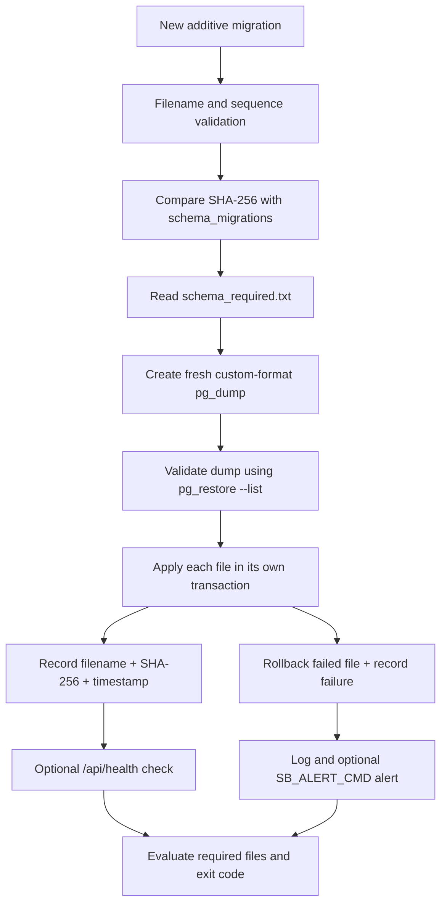

# Database change rules (MUST READ before touching the database)

Applies to every person and every AI (Claude, ChatGPT, Codex, anyone). If you cannot read this file, stop and tell the owner.

## 1. When this file applies

Read it BEFORE any change or advice that involves:
- creating, changing or removing a table, column, index, constraint, trigger, view or role/permission;
- changing or copying data, backfills, imports, clean-ups, resets;
- any file in `backend/schema/`, `backend/schema_required.txt`, or the scripts `backend/scripts/apply_schema.sh` (migration runner), backups, deploy or sync scripts;
- code that starts using a new table or column, or runs SQL that changes data;
- login, registration, customers, orders, payments, loyalty (the data that must never be damaged).

Not sure if it applies? It applies.

## 2. Who does what (hard rule)

| Work | Owner |
|---|---|
| All SQL: schema files, migrations, indexes, constraints, backfills, DB permissions | **Database Owner** |
| Migration runner, backup scripts, drift-check tooling, `schema_required.txt`, CI database check | **Database Owner** |
| Database review and migration review | **Primary Reviewer (Claude when available), Secondary Reviewer (ChatGPT)** |
| Application code (FastAPI, frontend, validation, tests, UI) | Any approved contributor |
| Running production actions, merge approvals, deployment approvals | **Repository Owner** |

The Database Owner retains final authority for all database decisions. Reviewers may recommend changes but may not bypass owner approval.

### Database Governance Roles

**Repository Owner**
- Final authority for all repository decisions.
- Final authority for all production database decisions.

**Database Owner**
- Owns schema design.
- Owns migration numbering.
- Owns migration review process.
- Owns schema compatibility decisions.
- Approves database changes before merge.

**Primary Reviewer**
- Claude (when available).
- Reviews migration safety and compatibility.

**Secondary Reviewer**
- ChatGPT.
- Reviews migration safety, compatibility and implementation impacts.

Reviewers provide recommendations only. The Repository Owner and Database Owner remain responsible for final approval. In this repository's current governance model, the Repository Owner and Database Owner are the same person.

If you are not the Database Owner and need a database change: do NOT write the SQL or modify protected database assets. Fill in the "Database Change Request" (section 9) and give it to the owner for approval and assignment. Writing unapproved SQL is how this project broke before.

## 3. Facts that must never be guessed

- Production database name is `sb_app`. Backend listens on `127.0.0.1:8001`. PostgreSQL port `5432`. (README)
- The old runner script contained `superbajaar` and port `8000`. Those are wrong; use the values above.
- Applied files are recorded in the table `schema_migrations` (file name + checksum). Failures are recorded in `schema_migration_failures`.
- Protected files, never edit, rename, delete or reformat: `000_baseline_schema.sql`, `009_loyalty_programme.sql`, and any file that may already be applied. Two numbers are used twice (`009` and `012`); both pairs are allowed and must not be renamed. Order is by full file name.
- Whether a file is applied on the server is only known from the server's ledger, never from Git. Ask the owner to run the check in section 8.

## 4. Rules for schema files

1. Never edit an existing schema file once it may have been applied. Any correction is a NEW file with the next unused number (check the folder AND the ledger).
2. One new schema file per change. Do not bundle unrelated changes.
3. Additive and repeatable only: `CREATE TABLE IF NOT EXISTS`, `ADD COLUMN IF NOT EXISTS`, `CREATE INDEX IF NOT EXISTS`, `ON CONFLICT DO NOTHING`. Running it twice must change nothing.
4. Forbidden on production: `DROP`, `TRUNCATE`, `DELETE`/`UPDATE` without a reviewed WHERE and a backup, column type changes that rewrite data, renaming tables or columns used by running code.
5. No `BEGIN`/`COMMIT` inside a file (the runner wraps each file in a transaction) and no `CREATE INDEX CONCURRENTLY`.
6. New unique rules must first be checked against live data (a read-only duplicate query is included in the change request). A unique index on data that already has duplicates fails the deploy.
7. Unique means unique inside one table for one purpose. One person can be a customer, employee, vendor, seller and partner, so a mobile number must never be made globally unique across roles. Customer mobile uniqueness applies to `customer_accounts` only.
8. Table names are lowercase with underscores. File names are `NNN_short_name.sql`, lowercase.
9. Test on a scratch Postgres 15 and 16 (twice, in order) before the pull request. Do not claim a pass without having run it.
10. If application code needs the new table or column, add that schema file to `backend/schema_required.txt` in the same pull request.
11. The migration runner must never grant blanket privileges on all tables or sequences in `public`. If the application needs access to objects created by a migration, that migration must declare explicit, least-privilege `GRANT` statements for only those objects and the intended application role. Do not use `GRANT ... ON ALL TABLES/SEQUENCES IN SCHEMA public`.
12. `000_baseline_schema.sql` is a one-time bootstrap for an empty database, not a repair script. If it is not recorded in `schema_migrations` while user objects already exist, the runner must stop before backup or schema changes. Never mark it applied manually just to bypass this guard.

## 5. How the safe deploy works (so nobody breaks it)

`apply_schema.sh <schema_dir>` does, in order: checks the database and migration ledger, refuses to bootstrap the baseline over an existing database, reads every file, takes and verifies a backup (no backup = no change), applies each new file in its own transaction (a failed file changes nothing), records every result, and alerts on any failure. It does not grant application-role permissions automatically; any required access must be explicitly and narrowly declared in the migration. A failed file is not retried until its content changes. Independent later files still apply.

Exit codes: `0` all good. `11` some file failed but every required file is applied (deploy may continue). `10` something failed and no required list exists (do not deploy). `20` a required file is missing (do not deploy; the old release stays live). `30` backup failed, nothing changed. `50` setup problem. `60` another run in progress.

The deploy continues only on `0` or `11`. Never change this behaviour, the exit codes, the backup step or the checksum rule without approval from the Database Owner and Repository Owner.

## 6. Rules for application code that touches the database

- No schema changes (`CREATE`, `ALTER`, `DROP`) in application code.
- A feature that needs a possibly-missing table must catch the error and fail only that feature, with a clear message, never the whole site.
- Wrong or hostile input (someone else's mobile number, repeated tries) must end in a clean error and change nothing: validate input, use one generic message for duplicates, rate-limit register and login, and keep each write inside one transaction.
- Never reveal whether an email or mobile number is already registered.

## 7. Before you start any database work: checklist

1. Read this file and the README safety section.
2. List `backend/schema/` and read the files that touch the same tables.
3. Ask the owner for the live checks in section 8 if the task depends on live state.
4. Write the Database Change Request (section 9) or, if you are the Database Owner, prepare the proposed new schema file for review.
5. Test twice on scratch Postgres 15 and 16. Open a pull request using the template. Never push to `main`.
6. The owner merges. The deploy applies the file. The owner confirms with `--status`.

## 8. Live checks the owner can run (read-only)

```
sudo -u postgres psql -c "\l"                                  # which database names exist
sudo -u postgres psql sb_app -c "SELECT filename, applied_at FROM schema_migrations ORDER BY applied_at DESC LIMIT 15;"
sudo -u postgres psql sb_app -c "\d customer_accounts"         # replace with the table in question
bash backend/scripts/apply_schema.sh backend/schema --status   # state of every file
tail -n 100 /home/ec2-user/deploy/schema.log
ls -lh /home/ec2-user/schema-backups/ | tail
```
Never paste passwords, keys or `.env` contents.

If the Primary Reviewer needs historical implementation context, it will ask the owner, who may ask another reviewer and relay the answer. Guessing is not allowed.

## 9. Database Change Request (template for contributors other than the Database Owner)

```
DATABASE CHANGE REQUEST
What the feature or bug needs (plain words):
Tables/columns involved:
Code that will use it (file names):
Should one person be allowed several roles? (customer/employee/vendor/partner):
Existing data that must be preserved:
Live data checks I could not do (owner to run):
Does the code require this change before it can deploy? (yes/no):
```

## 10. Release gates

Before merge, the owner must enable GitHub main-branch protection requiring both PostgreSQL matrix checks and up-to-date branches. Before production deployment, the owner must complete the read-only production preflight and confirm the live ledger/checksums and backup readiness. See `docs/DATABASE_CHANGE_RULES.md`. CI success alone is not production approval.

## 11. Definition of done

A database change is done only when: the schema file passed twice on scratch Postgres 15 and 16, the CI check is green, the owner merged it, the runner log shows it applied, `--status` shows it as APPLIED, and the feature works on the live site. Anything else is "not done".


---

## 12. Database design principles

These principles complement the operational rules above and define the intended quality of database changes.

- Do not perform destructive schema resets during application startup.
- Do not use `DROP DATABASE`, `DROP SCHEMA`, `DROP TABLE` or `TRUNCATE` as part of routine deployment.
- Schema evolution must use a versioned migration with a clear forward path and documented backup/recovery approach.
- Seed data must be idempotent and must never contain real customer, payment or credential data.
- Store monetary amounts using fixed-precision decimals or integer minor units; use explicit currency and tax treatment, and preserve audit timestamps.
- Orders, payment attempts, refunds, stock movements and accounting journals need stable identifiers and idempotency protections.
- Use environment configuration for database connections. Never print credentials in logs.
- Local and test databases must be explicitly configured and must never silently fall back to production.
- This handbook describes rules; it does not itself inspect, connect to, migrate, clear or modify any database.

## 13. GitHub merge protection and production release preflight

This section combines the database release gates with the migration rules above. It does not authorize automatic production deployment.

### A. GitHub merge protection (owner action)

1. Open **Settings → Rules → Rulesets** (or **Settings → Branches → Branch protection rules**, depending on repository configuration).
2. Create or edit the rule targeting `main`.
3. Require a pull request before merging.
4. Require both PostgreSQL matrix checks produced by the `Database files check` workflow: `database-files (15)` and `database-files (16)`. If GitHub displays different exact labels, select the two jobs corresponding to PostgreSQL 15 and 16.
5. Require branches to be up to date before merging.
6. Save and verify the rule is active for `main`.

Both matrix checks are required because migrations must pass on both supported PostgreSQL versions. Branch freshness ensures PRs are tested against the latest `main`. Only repository rules enforce these requirements; documentation cannot enable them.

### B. Production preflight (owner-only, read-only)

Run these checks on the production server from the intended release checkout. Do not paste passwords, connection strings, `.env` contents or secret values into a PR or chat. Do not run a migration during preflight.

Confirm the checkout and runtime targets:

```bash
pwd
git status --short
git branch --show-current
git rev-parse HEAD

sudo -u postgres psql -X -v ON_ERROR_STOP=1 -d sb_app -Atc \
  "SELECT current_database(), current_setting('server_version'), current_setting('port');"
```

Expected database: `sb_app`; expected PostgreSQL major version: 15; backend port: `8001`; PostgreSQL port: `5432`. If any target differs, stop and investigate.

Check the live migration ledger and runner status:

```bash
sudo -u postgres psql -X -v ON_ERROR_STOP=1 -d sb_app -c \
  "SELECT filename, sha256, applied_at FROM schema_migrations ORDER BY applied_at;"
bash backend/scripts/apply_schema.sh backend/schema --status
echo "runner_status_exit=$?"
```

The status command is read-only. A non-zero result, changed checksum, pending required file, missing ledger or unexpected ledger shape means **stop**. Compare every applied file with its live ledger checksum and investigate ledger entries whose files are absent from the checkout. Never bypass a baseline guard by inserting a ledger row manually.

Confirm backup storage:

```bash
ls -ld /home/ec2-user/schema-backups
ls -lh /home/ec2-user/schema-backups/ | tail -n 10
```

Before an actual migration, the runner must create and validate a fresh custom-format backup itself. If backup creation or `pg_restore --list` validation fails, it must stop before applying schema files. An old backup is not a substitute for a fresh pre-change backup.

Record only non-secret facts in the PR: production database name, PostgreSQL major version, current commit, runner status and exit code, whether required files/checksums match, and whether backup storage is available. Mark any incomplete check **NOT VERIFIED** and stop.

### C. What CI does and does not prove

CI runs the schema set twice on disposable PostgreSQL 15 and 16 services and runs migration-runner tests against throw-away databases. Tests include refusal to apply an unrecorded baseline over a populated database and least-privilege permission handling. CI also checks protected legacy filenames and migration-number collisions.

CI does **not** connect to production, inspect the live migration ledger, validate production data, create a production backup or enable GitHub branch protection. Those remain explicit owner responsibilities.


---

## 14. Implemented schema automation — actual runner contract

This section documents the checked-in implementation in `backend/scripts/apply_schema.sh`, `backend/schema_required.txt`, `backend/scripts/tests/test_apply_schema.sh` and `.github/workflows/migration-check.yml`. If code changes, update this section in the same PR.

### Components and responsibilities

| Component | Responsibility |
|---|---|
| `backend/schema/*.sql` | Ordered SQL migration files named `NNN_lowercase_name.sql` |
| `backend/schema_required.txt` | Files the current application release requires to be applied |
| `backend/scripts/apply_schema.sh` | Classifies files, checks the ledger, creates/validates backup, applies transactions and records results |
| `schema_migrations` | Applied filename, SHA-256 and applied timestamp |
| `schema_migration_failures` | Failure history for failed migration attempts |
| `backend/scripts/tests/test_apply_schema.sh` | Runner tests for backup, rollback, failures, alerts and exit codes |
| `.github/workflows/migration-check.yml` | Disposable PostgreSQL 15/16 schema and runner test matrix |

### End-to-end flow



### Runner modes

| Command mode | Behaviour |
|---|---|
| Default | Apply pending files using the guarded process |
| `--dry-run` | Classify/show what would be applied; make no schema changes |
| `--status` | Show applied, pending, changed and previously failed files; read-only |
| `--retry` | Permit retry of previously failed files with the same content |

The runner obtains the database name from `SB_DB` (default `sb_app`), uses the configured PostgreSQL command wrappers, defaults backup storage to `/home/ec2-user/schema-backups`, and defaults the health URL to `http://127.0.0.1:8001/api/health`. Environment overrides exist; never expose their values if they contain secrets.

### Safety behaviour implemented in the runner

- Uses a lock to prevent concurrent runs.
- Validates migration filename format and computes SHA-256 for each file.
- Reads the `schema_migrations` ledger and refuses to guess if the ledger is missing while user objects exist.
- Refuses to apply an unrecorded baseline over a database that already contains user objects.
- Detects applied files whose content has changed; it reports the mismatch and does not reapply the edited file.
- Reads the required migration list and verifies every listed file exists in the schema directory.
- Creates a fresh custom-format database backup before applying pending files and validates it with `pg_restore --list`. Backup failure exits before applying migrations.
- Runs each migration file in its own transaction and records its filename/checksum on commit.
- Records failed migration details; a failed file is rolled back. Independent later files may still be attempted unless configured to stop.
- Sends alerts only when `SB_ALERT_CMD` is configured.
- Performs an optional health request after the application attempt when `SB_HEALTH_URL` is non-empty.

### Exit-code contract

| Code | Meaning / release handling |
|---:|---|
| `0` | All schema files are applied and no outstanding issue was detected |
| `10` | A file failed/changed or remains outstanding when no required-file list is available; strict stop |
| `11` | Some non-required file failed/changed, but every required file is applied; runner says deployment may continue, subject to the release owner |
| `20` | At least one file required by this release is not applied; do not deploy |
| `30` | Backup failed; no migration was applied |
| `50` | Setup/validation/database/ledger problem; stop |
| `60` | Another runner instance holds the lock; stop and investigate |

The runner header states that deployment should continue only on 0 or 11. A production release still requires owner approval and all other release gates. Do not infer success solely from a shell command returning; capture the exact exit code and runner log.

### Required-file release gate

When application code starts relying on a new schema file, the exact migration must be listed in `backend/schema_required.txt` in the same approved change. The runner blocks the release with code 20 if a required file is not applied. CI also verifies that every non-comment manifest entry names a real file.

Only the designated database author may edit the manifest under current policy, unless the owner explicitly authorizes a scoped exception recorded in the PR.

### CI coverage and its limits

The migration workflow:

1. Runs on disposable PostgreSQL 15 and 16 services.
2. Checks migration filename format and protected historical migration pairs.
3. Applies every SQL file in sorted order.
4. Applies the complete set a second time to test repeatability.
5. Runs the migration runner test suite for backup, rollback, failure, alert and exit-code behaviour.
6. Verifies manifest entries refer to existing migration files.

This CI does not connect to production, inspect the production ledger, validate production records, create a production backup, or prove that the deployed service uses the PR commit.

### Production operation boundary

Production preflight is owner-only and read-only. It must verify the intended checkout, target database `sb_app`, PostgreSQL version/port, live migration ledger, exact file checksums, runner `--status`, and backup storage. Any unexplained mismatch is a stop condition. A real migration is a separate explicitly approved action; do not treat documentation, CI or preflight as authorization to apply it.
