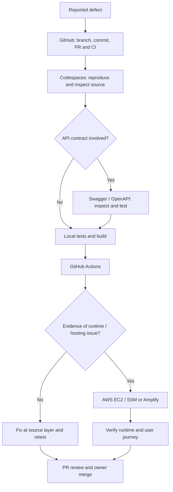

# Development, GitHub and Operations Workflow

> **Purpose:** One operational guide for choosing the right tool, diagnosing the right layer, managing pull requests and verifying releases. The README is the overview; this document is the detailed workflow.

## 1. Tool register

| Tool / service | Primary responsibility | Use it for | Not a substitute for |
|---|---|---|---|
| GitHub | Source of truth | Branches, commits, PRs, reviews, Actions, repository history | Running or debugging the live application |
| GitHub Codespaces | Primary development workspace | Read/edit source, reproduce bugs, run tests/builds, inspect dependencies and local logs | Production runtime verification |
| Swagger / OpenAPI | API contract and interactive endpoint testing | Routes, schemas, auth, request/response, status codes and reproducible API tests | Frontend rendering or production infrastructure diagnosis |
| ChatGPT | Technical lead and coordinator | Planning, architecture, analysis, review, documentation and evidence-based decisions | Executing a test unless a runner/tool actually ran it |
| Claude | Designated database/SQL/runner author by current project policy | Scoped schema, migration runner and database review work | Owner approval or live production authorization |
| GitHub Copilot | Additional AI coding assistant; capabilities depend on the assigned plan | Code completion, explanations, bounded implementation, test suggestions and first-pass review where enabled | Human review, required CI, repository safety rules, database authorisation or owner approval |
| GitHub Actions | Automated CI | Backend tests, frontend builds, schema tests and PR quality gates | Production DB checks or post-deployment E2E verification |
| AWS EC2 | Backend host | Runtime, OS, process, networking, disk, logs and environment investigation | Source-code development |
| AWS Systems Manager Run Command | Remote EC2 operations | Approved read-only diagnostics and explicitly approved commands | An unrestricted substitute for review/approval |
| AWS Amplify | Frontend hosting/build | Build logs, deploy status, hosting and frontend release checks | Backend API or database diagnosis |
| PostgreSQL | Persistent data store | SQL, schema, constraints, transaction and integrity inspection | A place for unreviewed manual production fixes |
| Nginx | Reverse proxy | HTTPS, host routing, upstream and proxy diagnostics | FastAPI business logic |
| Gunicorn + FastAPI | Backend application runtime | Process, route registration, middleware and application behaviour | Frontend build/hosting |
| systemd service/timer | Existing process and scheduled operations | Service state, timer schedule, execution status and journal logs | A reason to change the cadence or replace automation |

Only list additional products as active integrations after verifying their actual repository configuration, workflow or deployed connection. A product discussed during planning is not automatically an implemented dependency.

## 2. Diagnostic order and decision matrix

Use the following order for normal development. Follow the evidence: skip directly to the relevant layer during a confirmed incident, outage or security event.

| Problem | First tool | Inspect | Escalate to |
|---|---|---|---|
| Page, layout, React state, form or browser error | Codespaces + browser developer tools | Component, route, state, network request, console | Swagger if API contract is implicated |
| API route missing / wrong payload / 401 / 403 / 404 / 422 | Swagger / OpenAPI | Route, schema, auth, headers, request, response and status | Codespaces to inspect implementation |
| API 500 or timeout | Swagger first | Reproduce request, response body, request ID if available | Codespaces for traceback/code; AWS only if runtime evidence points there |
| Database undefined table/column/constraint | Codespaces | SQL migration, query, model and required-schema manifest | Read-only DB inspection by authorized owner if environment state matters |
| Migration test failure | GitHub Actions | Exact failing job/step and commit | Reproduce against disposable PostgreSQL 15/16 in Codespaces |
| Backend service down / process crash / port unreachable | AWS EC2 or SSM | systemd, Gunicorn, Nginx, logs, port 8001, host health | Infrastructure owner |
| Frontend deployment/build issue | GitHub Actions then Amplify | Build command, artifact, environment configuration, deploy state | Frontend code in Codespaces |
| Timer or scheduled synchronization issue | AWS EC2 / systemd | Timer status, last/next trigger, service result and journal | Operations owner |
| Production ledger/checksum mismatch | Owner-only database preflight | Live ledger, file checksums, target DB and backup readiness | Database owner; stop release until reconciled |

### Normal diagnostic sequence

Do not use AWS as the first debugging destination for ordinary source, UI or API contract defects. Do not use a green CI result to claim production health.

## 3. GitHub branch and pull-request lifecycle

### Required flow

1. Fetch latest `main` and create a focused feature branch from it.
2. Read README, AGENTS and the relevant canonical technical documents.
3. Implement only the agreed scope; preserve unrelated working code.
4. Run relevant local checks in Codespaces.
5. Update relevant docs and add a dated entry to `IMPORTANT_UPDATES.md` for major changes.
6. Open/update the PR using the repository template.
7. Review the complete diff, schema impact, docs impact and CI evidence.
8. Address review comments and keep the branch current with `main`.
9. Repository owner merges only when required checks and review conditions are met.
10. Deployment is a separate, explicitly approved action; record post-deployment verification.

### PR operating policy

| Control | Policy |
|---|---|
| Open PR portfolio | Normal operating ceiling: **15 open PRs** |
| Resolution target | **5 calendar days** from opening |
| Escalation | Review blocker/owner/next action by Day 7 |
| Maximum target window | Resolve by **Day 10** through merge or closure with a reason |
| Required ownership | Every PR has an accountable owner and clear scope |
| Required quality | Acceptance criteria, tests, documentation impact and CI evidence |
| Stale / blocked PR | State blocker, responsible person and next review date |
| Urgent exception | Security/production incident PRs may exceed the cap with owner visibility |

These are operating targets, not automatic GitHub enforcement. Unless an approved GitHub App or scheduled automation is configured, the repository does not automatically count open PRs or close aged PRs.

**No metric-driven unsafe merge:** Never merge merely to meet the five/ten-day target. Never close valid work just to reduce the count. If work cannot safely merge, keep it blocked with a documented owner and next review date, and escalate the portfolio exception.

### PR state vocabulary

Draft → Ready for review → In review → Changes requested / Blocked → Approved → Merged or Closed.

A closed PR must have a short reason (superseded, duplicate, no longer required, unsafe, abandoned with owner decision, etc.). Merged means integrated into the target branch; it does not mean deployed.

## 4. AI team collaboration and delegation

Use [AI Team Collaboration & Delivery Policy](AI_TEAM_COLLABORATION.md) as the canonical source for contributor roles, file ownership, batch sizing, handoffs, review and stop conditions. The policy treats the owner as final decision-maker and ChatGPT as coordinator; Claude, Copilot, Perplexity and Gemini have distinct, bounded responsibilities. GitHub issues, branches, PRs and Actions are the shared project record; separate AI chat sessions do not communicate directly.

Keep Claude and Copilot implementation batches to 2–3 related files where practical, assign non-overlapping file sets, and start the next batch only after the prior batch is reviewed. Use two focused work windows per day separated by roughly 3–4 hours when practical; this is a planning preference, not an automatic background schedule. Perplexity starts read-only until repository access is verified. Gemini reviews only the exact excerpts, diffs or screenshots supplied. Verify actual plan, permissions and repository coverage before relying on any agent feature.

GitHub Copilot remains an additional coding assistant, not a replacement for the owner, technical lead, designated database author, CI or human review. Its actual plan and enabled capabilities must be checked in the account; repository integration alone does not prove paid access, cloud-agent eligibility or unlimited usage. See [GitHub Copilot plans, limits and repository policy](GITHUB_COPILOT.md). All contributors must follow `AGENTS.md`, work on feature branches, preserve protected files and provide exact test/CI evidence. No agent may merge, bypass branch protection, deploy, change production data/secrets/infrastructure, or take over protected SQL/migration authorship.

## 5. Codespaces: primary use

Use Codespaces extensively as the primary place to:

- inspect the actual repository tree and current branch;
- trace a UI action through API client, backend route, business logic and SQL;
- edit source and documentation on a feature branch;
- run backend tests, frontend lint/build and migration-runner tests;
- reproduce errors against disposable/local services;
- inspect diffs and prepare PR evidence.

Before running commands, confirm repository, branch, working tree and commit. Never point a local test at production credentials or database. Keep secrets out of terminal output and screenshots.

## 6. Swagger / OpenAPI: primary use

Use Swagger first for API-specific defects:

- confirm the expected route is registered;
- inspect method, path, parameters, request body and response schema;
- authenticate with the correct staff/customer token type;
- test status codes, validation errors and permissions;
- capture reproducible request/response evidence.

Swagger is commonly available at the FastAPI OpenAPI UI path (for example `/docs`) on the configured backend host. Confirm the deployed URL and environment rather than assuming a URL. A successful Swagger request proves only that specific request in that environment; it does not prove the frontend journey or all roles.

## 7. AWS: when and how to use it

Use AWS only when evidence indicates server, runtime, networking, environment, hosting, deployment or production database concerns.

### EC2 / Systems Manager Run Command

Appropriate checks include:

- systemd service and timer status;
- Gunicorn process and listener on `127.0.0.1:8001`;
- Nginx service and upstream/proxy logs;
- backend application logs and recent deployment commit;
- disk, memory, CPU, connectivity and TLS/networking;
- approved read-only PostgreSQL checks.

Run Command is for controlled remote execution. Prefer read-only commands first. Destructive commands, service changes, migration application, secret changes and deployment require explicit owner authorization and a reviewed plan.

### AWS Amplify

Use Amplify for frontend build/deploy state, build logs, hosting configuration and the deployed frontend. If the build fails, inspect the exact failed command and dependency/build output; reproduce in Codespaces where possible before changing configuration.

### Fixed runtime constraints

- EC2 backend behind existing Nginx and Gunicorn.
- Backend listener: `127.0.0.1:8001`.
- PostgreSQL: `5432`; production database name: `sb_app`.
- Existing systemd service/timer and synchronization flow must be preserved.
- Existing Amplify frontend hosting must be preserved.
- Public API prefix remains `/api`.

Do not change these targets as a workaround. Verify the real environment before any operation.

## 8. Release and verification gates

| Gate | Evidence required |
|---|---|
| Source complete | Diff reviewed; acceptance criteria addressed |
| Local verification | Exact commands and results recorded |
| CI verified | Required GitHub Actions checks green on exact commit |
| PR approved | Review complete; branch current; owner approval |
| Merged | GitHub confirms merge SHA |
| Deployment approved | Owner authorization and release plan |
| Deployed | Environment and deployed commit recorded |
| Post-deploy verified | Health, logs and relevant end-to-end journeys passed |

For schema releases, follow `docs/DATABASE_CHANGE_RULES.md`; the production preflight and live migration runner are owner-controlled. CI never substitutes for live ledger and backup checks.
