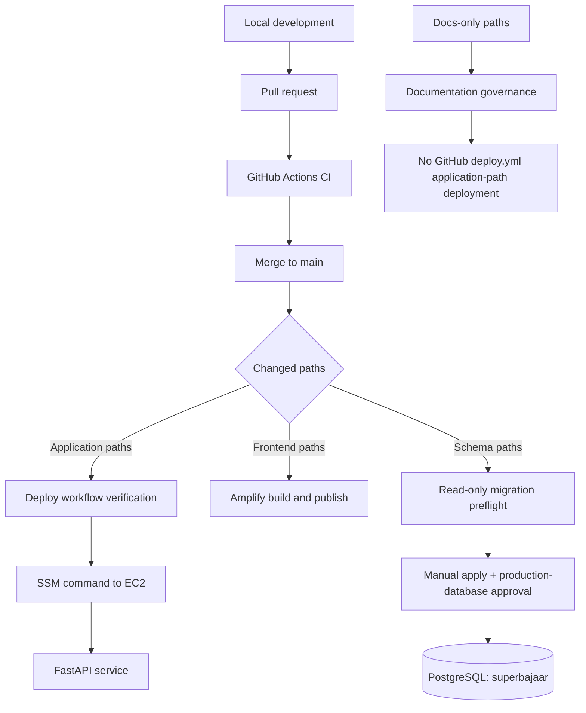

# Production governance, deployment and recovery

> **Canonical operational snapshot — 12 November 2026**  
> **Status:** Owner-approved decisions recorded; several live checks remain outstanding.  
> **Scope:** GitHub release controls, AWS deployment access, production database migration governance, backup evidence and rollback.  
> **Approval boundary:** This document records decisions and procedures. It does not authorize a production deployment, database restore, IAM change or infrastructure mutation.

## Executive status

Super Bajaar has three distinct execution contexts: local development, ephemeral GitHub Actions CI, and production. CI is not staging. Production comprises separately controlled frontend hosting (Amplify), backend runtime (EC2/SSM) and PostgreSQL on the EC2 host.

| Area | Current recorded state | Evidence classification |
|---|---|---|
| IAM approval boundary | Main-ref OIDC trust can reach the deploy role; owner accepts this risk for now. A separate environment-only apply role is deferred. | Owner decision + run #9 observation |
| Production database reviewer | Owner is the sole required reviewer and deliberately retains self-approval authority. | Owner decision (12 Nov 2026) |
| Backend rollback | Last-good SHA fix is merged in commit `4580ad3f2ed2155ba466932b2ac0bad229a5b0f1`; live deployment/ref verification is outstanding. | Git-confirmed; runtime unverified |
| Migration 045 | Applied and verified; ledger reports 41, checksum recorded below. | Owner-provided production verification |
| Vendor/bootstrap IAM | Vendor policy JSON and bootstrap parameter existence have not been verified. | Open verification |
| Backups | A restorable pre-045 dump exists on instance storage; no off-instance mechanism was observed. | Backup evidence; off-instance status unknown |

## 1. Environment and release model



- **Local:** developer workstation and explicitly selected local/test services.
- **CI:** ephemeral test jobs and disposable PostgreSQL. Not a persistent staging environment.
- **Production:** AWS Amplify frontend, EC2-hosted FastAPI backend, and self-managed PostgreSQL on EC2.
- **Staging:** no dedicated staging environment is evidenced in the repository configuration reviewed for this record. Do not describe CI as staging.

A commit to `main` does not mean every component deploys. Workflow path filters and job conditions decide what runs. Verify the exact workflow run, job outcomes, deployed commit marker and service health before calling a release live. A schema-path push performs read-only preflight; applying SQL is a separate manually dispatched and approval-gated action.

## 2. IAM approval bypass — accepted risk

**Decision:** YES, the current trust arrangement can permit IAM approval bypass for the database apply path. The owner explicitly accepts this risk for now.

### Evidence and interpretation

- Run #9 used a status job without a GitHub Environment. The main-branch OIDC subject assumed `SuperBajaarGitHubDeploy` and returned live database status.
- The role permits `ssm:SendCommand` with `AWS-RunShellScript` on EC2 instance `i-08814a9225c19ee91`. A workflow running under that trusted subject can therefore execute commands on the instance within the role's permissions.
- The GitHub `production-database` reviewer gate is a workflow/environment control. It is not, by itself, an IAM trust-policy boundary.
- The owner reports that the trust policy's `sub` condition is a list containing both the main-ref subject and the `production-database` environment subject.
- The owner reports that main has no branch protection because the owner removed the rule.

### Owner decision

The sole owner accepts the current risk because there is no team. A separate, narrowly scoped database-apply role trusted only by the `production-database` environment subject is deferred.

**Required future improvement:** separate read-only/status access from production apply access. The apply role should trust only the exact repository + protected environment OIDC subject, have the minimum required SSM/database permissions, and not be assumable by an ordinary main-ref job. Review branch/ruleset protections when a second contributor or reviewer is introduced.

Do not describe the GitHub environment gate as an IAM guarantee.

## 3. Production self-approval — explicit owner decision

### 2. SELF-APPROVAL: YES. OWNER RETAINS REVIEWER AUTHORITY BY DECISION.

**Evidence:** run #10 attempt 2 was re-run by `siinghniibandhan-wq` and approved by the same account on `production-database`. The "Prevent self-review" setting page was never viewed, so it is inferred off.

**Owner decision (12 Nov 2026):** the owner is the sole required reviewer on `production-database` and retains full authority to approve their own production migrations. "Prevent self-review" stays off, because there is no team and enabling it with one reviewer would block all approvals. "Allow administrators to bypass" was unticked by the owner (reported, not seen on screen). Revisit when a second reviewer is added.

### Changes recorded

- `production-database` reviewer: owner only (sole reviewer, by decision).
- The owner accepts the absence of independent second-person review as a current operational risk.
- Admin-bypass checkbox state is owner-reported, not independently screenshot-verified.
- Do not claim that the settings page was inspected. A screenshot showing required reviewers and the bypass checkbox is the evidence needed to independently verify the visible configuration.

## 4. Backend deployment and last-good rollback

### Failure mechanism

The EC2 source-sync timer runs `sync_main.sh` and can fast-forward `/opt/superbajaar/source` to the new `main` commit before the deployment workflow starts. The sync and deployment scripts share a lock, which prevents simultaneous checkout mutation but does not guarantee which scheduled operation runs first.

If deployment records `HEAD` as its rollback point after sync has already advanced the checkout, the rollback point may equal the new target. A failed deployment can then restore the same broken source revision.

### Implemented fix

The fix is merged in PR #63, merge commit `4580ad3f2ed2155ba466932b2ac0bad229a5b0f1`.

The deployed script now:

1. Reads `refs/deploy/last-good` as the rollback SHA when that ref exists.
2. Falls back to current `HEAD` on the first deployment, when no saved ref exists.
3. Fetches and fast-forwards to the requested target SHA.
4. Installs dependencies, compiles the backend, restarts `superbajaar-backend.service`, checks API health and validates the HR route.
5. On failure, resets to the saved rollback SHA, restores dependencies, restarts the service and checks health.
6. Only after all deployment checks succeed, updates `refs/deploy/last-good` to the verified deployed `HEAD`.

The final success sequence in `backend/scripts/deploy_backend.sh` is:

```bash
rollback_needed=0
git update-ref refs/deploy/last-good "$(git rev-parse HEAD)"
trap - EXIT
log "Deployment verified: $(git rev-parse HEAD); health=OK; HR route HTTP $hr_code"
```

The rollback point is a Git ref on the EC2 checkout; it is not a database backup and does not reverse schema changes.

### First deployment after the fix

If `refs/deploy/last-good` does not yet exist, the script deliberately falls back to `HEAD`. After that deployment passes all verification steps, it writes the ref. The first successful deployment establishes the persistent last-good reference; it cannot use a previously saved last-good ref that does not exist.

### Verification still required

Do not claim the fix is live until all of the following have been observed for the deployment associated with commit `4580ad3` (or a later qualifying deployment):

```bash
sudo -u ubuntu git -C /opt/superbajaar/source rev-parse HEAD
sudo -u ubuntu git -C /opt/superbajaar/source rev-parse refs/deploy/last-good
sudo systemctl is-active superbajaar-backend.service
curl --fail --silent --show-error https://superappkart.duckdns.org/api/health
```

Also confirm the GitHub Actions `Deploy Super Bajaar backend` run and its EC2 SSM job result. A workflow-level success that skips the EC2 job is not a production deployment.

**Deployment verification status at the time of this record:** not yet confirmed for `4580ad3`; server `HEAD`, `refs/deploy/last-good`, service state and HTTP 200 remain outstanding.

## 5. Database migration governance

### Production target

| Setting | Recorded production value |
|---|---|
| Database | `superbajaar` |
| Application role | `superbajaar_app` |
| PostgreSQL | EC2-local, port 5432, host 127.0.0.1 |
| Checkout | `/opt/superbajaar/source` |
| Schema directory | `/opt/superbajaar/source/backend/schema` |
| Migration runner | `backend/scripts/apply_schema.sh` |
| Required manifest | `backend/schema_required.txt` |

The runner's fallback `sb_app` is historical and is not the confirmed production database. Production commands must explicitly set `SB_DB=superbajaar`.

### Migration 045 — applied and verified

| Field | Recorded value |
|---|---|
| File | `045_identity_claim_cancellation_event.sql` |
| Production result | Applied and verified (owner-reported 12 Nov 2026) |
| Migration ledger count | 41 |
| SHA-256 | `874886ce7aae2bc6c4f541e95f63bf231ac06b187a62aeb94cef6f58cbf2b948` |
| Constraint | Includes `link_cancelled` |
| Identity event rows | 0 |

The zero-row `identity_events` result is a count at verification time; it does not mean the migration failed. Do not reapply migration 045. Reconfirm the ledger and checksum with a read-only status query before any subsequent database operation.

### Immutable migration controls

- New schema files use `NNN_lowercase_description.sql` with unique three-digit prefixes.
- Never renumber, edit, move or delete an applied migration. A correction is a new unused migration.
- SQL files contain schema/data changes only, never shell, deployment, systemd or CI configuration.
- A verified pre-change backup is required before an approved apply.
- Each migration is applied in its own transaction and recorded with a checksum.
- The scheduled schema runner is status-only; a timer tick is not permission to apply.
- A Git merge, CI pass or green deployment workflow does not authorize a production schema change.

## 6. Backup and recovery posture

### Known evidence

A restorable pre-045 custom-format dump was reported on the EC2 instance:

- File: `superbajaar-pre-045-20261112T085030Z.dump`
- SHA-256: `de8fadf361d29e195c37a75a7fc08b17fbd185c0a2793cda309422635d44b24e`
- Location: `/var/lib/superbajaar/backups`
- Owner reports the dump is restorable.

Manual dumps and migration-runner pre-migration dumps were also observed on the instance disk. The 0-byte dump was removed and the new dump plus checksum file were chowned to `ubuntu`.

### What is not established

**Accurate conclusion: no off-instance mechanism was observed.** This is not proof that none exists.

Not yet checked: scheduled EBS snapshots, Data Lifecycle Manager (DLM), AWS Backup, S3 copy/replication, lifecycle retention or an independent restore test from an off-instance copy.

### Recovery policy

1. Preserve the pre-045 dump and checksum.
2. Before each production migration, create and validate a fresh dump.
3. Inspect AWS snapshot/backup configuration and S3 destinations before making claims about off-instance protection.
4. Decide and document retention, encryption, access controls, RPO and RTO.
5. Test restore to an isolated database before relying on a backup as a recovery control.
6. Never restore over production without a separate explicit approval and impact assessment.

## 7. Vendor and bootstrap IAM verification

- The `SuperBajaarVendorPort...` policy JSON was not inspected; its S3-related permission scope remains unverified.
- `SuperBajaarDeleteBootstrapPassword` reportedly allows `ssm:DeleteParameter` only on `/superbajaar/bootstrap/super-admin-password`.
- Whether that Parameter Store parameter still exists has not been checked. Therefore whether the delete policy is still required is unknown.
- Do not delete the policy or parameter, broaden permissions, or infer that bootstrap provisioning is complete without checking the exact policy document and parameter metadata.

## 8. Open actions and acceptance criteria

| Priority | Action | Completion evidence |
|---:|---|---|
| 1 | Verify deployment for `4580ad3` / later qualifying commit | Workflow + EC2 SSM job succeeded; server HEAD and last-good ref; service active; health HTTP 200 |
| 2 | Inspect vendor policy and bootstrap parameter | Exact IAM policy JSON and Parameter Store existence/metadata recorded |
| 3 | Inspect off-instance backup controls | EBS/DLM/AWS Backup/S3 configuration and retention findings recorded |
| 4 | Decide backup retention and off-instance copy | Owner-approved RPO/RTO, retention, encryption and restore-test plan |
| 5 | Revisit reviewer model when a second reviewer is added | Updated environment reviewers and self-review setting verified |
| 6 | Consider separate apply IAM role | Environment-only trust and least-privilege policy reviewed and tested |

## 9. Change log and evidence discipline

- **12 Nov 2026:** Owner-approved IAM/self-approval decisions recorded; migration 045 reported applied and verified; last-good rollback fix merged; pre-045 dump identified.
- **12 Nov 2026:** This document consolidates the current production governance position. It supersedes older conflicting point-in-time status statements only where explicitly noted above. Historical incident records remain historical evidence.

Every status statement must be labelled as one of:
- **Verified from Git/source:** reproducible from repository content or commit history.
- **Observed live:** captured from the relevant AWS, GitHub, EC2 or database interface at a stated time.
- **Owner-reported:** provided by the system owner but not independently inspected.
- **Inferred:** derived from other evidence and explicitly identified as inference.
- **Open/unverified:** evidence has not yet been collected.

Do not convert owner-reported or inferred settings into independently verified facts.
