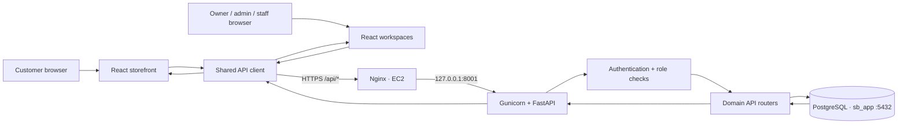
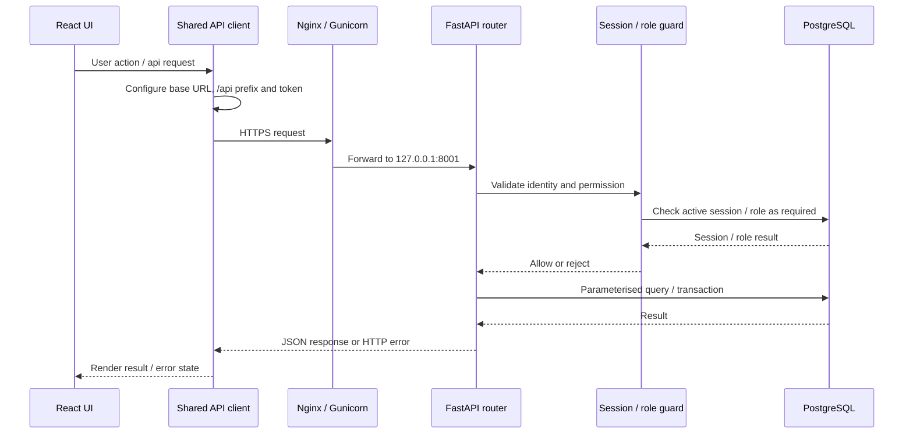
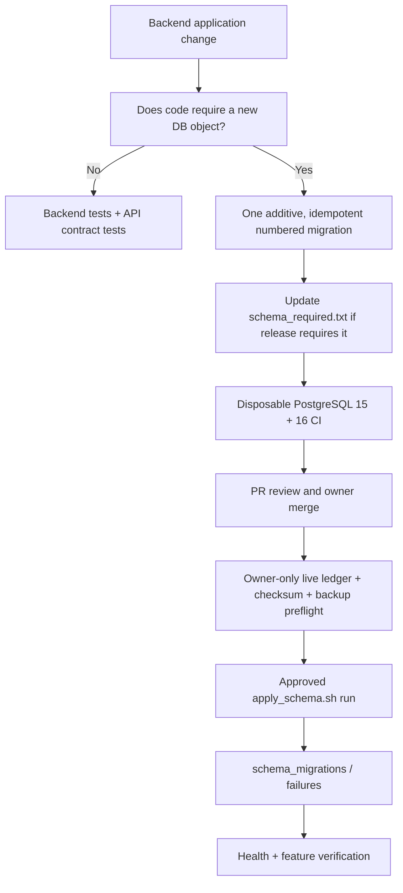

# Architecture and API Contracts

> **Purpose:** Canonical technical description of the running application architecture, request/data flow, domain boundaries and API contracts. The README provides the short overview; this document owns the detailed technical reference.

## 1. Architecture principles

1. Keep one authoritative backend API and one persistent PostgreSQL data store.
2. Frontend pages call the shared API client; browser code never connects directly to PostgreSQL.
3. Backend handlers validate input, authenticate callers, enforce roles and apply server-side business rules.
4. Keep durable business records in PostgreSQL; use explicit transactions for multi-record operations.
5. Make retryable operations idempotent, especially payments, webhooks, orders, stock movements and synchronization.
6. Do not reset or destructively recreate production schema during application startup.
7. Document implemented behaviour separately from target architecture or planned modules.

## 2. Runtime topology

| Component | Current documented implementation | Responsibility |
|---|---|---|
| Customer storefront | React + Vite | Customer browsing and checkout UI |
| Admin / internal UI | React + Vite workspaces | Catalogue and operational administration |
| Frontend hosting | AWS Amplify | Build and serve frontend |
| API client | `frontend/src/services/api.js` | Base URL, `/api` prefix, auth headers, response/error handling |
| Reverse proxy | Nginx on existing AWS EC2 | HTTPS and upstream routing |
| Application server | Gunicorn + FastAPI | HTTP API runtime |
| Backend listener | `127.0.0.1:8001` | Internal backend listener |
| Database | PostgreSQL, `sb_app`, port `5432` | Persistent application data |
| Process operations | Existing systemd service/timer | Backend process and scheduled synchronization |
| CI | GitHub Actions | Backend tests, frontend builds and schema checks |

Do not change the established ports, services, hosting or API prefix without owner approval and a verified migration plan.

## 3. System context and request flow

### Request lifecycle

1. A page calls the shared API client.
2. The client applies the configured backend URL and single `/api` prefix, then attaches the correct token when required.
3. Nginx forwards the request to FastAPI through Gunicorn on port 8001.
4. Middleware/dependencies validate public-route exceptions, active sessions and roles.
5. The domain router validates the request, applies business rules and interacts with PostgreSQL.
6. The API returns a structured response; the frontend renders it.

The server, not the browser, is authoritative for price, tax, permissions, stock and order totals.

## 4. Source layout — actual implementation versus target pattern

### Current source map

- `frontend/src/main.jsx`: React entry.
- `frontend/src/app/`: application shell and routing.
- `frontend/src/pages/`: page/workspace entry points.
- `frontend/src/features/`: feature-specific UI and workflows.
- `frontend/src/components/`: reusable components.
- `frontend/src/layouts/`: shared layouts.
- `frontend/src/services/api.js`: shared API client.
- `backend/app/main.py`: FastAPI app, middleware and router registration.
- `backend/app/core/`: configuration and authentication infrastructure.
- `backend/app/api/`: HTTP route handlers.
- `backend/tests/`: backend tests.
- `backend/schema/`: versioned SQL migration files.
- `backend/scripts/apply_schema.sh`: schema migration runner.
- `backend/schema_required.txt`: release-required schema files.

Some current route handlers contain direct database access. A fully separated service/repository architecture is a design direction, not an assumption that every module already follows it. Do not restructure working modules solely to match an idealized folder diagram.

## 5. Domain boundaries

| Domain | Responsibility / data boundary |
|---|---|
| Identity and access | Staff/customer authentication, sessions, roles and permissions |
| Catalogue | Categories, products, attributes, variants and product images |
| Pricing | Variant prices, tax treatment and promotions |
| Inventory | Locations, balances, movements and adjustments |
| Purchasing | Suppliers, purchase orders and receiving |
| Orders | Checkout, order lifecycle and order summaries |
| Payments | Payment records and provider status; do not assume gateway capture/refund is implemented |
| Delivery | Shipment records, serviceability and delivery status |
| Customers / CRM | Customer records, support cases and related activity |
| Loyalty | Programme, referrals and points-related records |
| POS | In-person sales workflow |
| Accounting / tax | Financial records, tax calculations and reporting; verify implementation before relying on scope |
| HR / payroll | Employee and payroll operations; verify implementation before relying on scope |
| Reporting | Cross-domain read models and operational reporting |

Cross-domain workflows must preserve referential integrity and use explicit transactions where one business action changes multiple records.

## 6. API contract and access policy

All public API paths use the single `/api` prefix. Confirm the current route declaration and OpenAPI schema before implementing against a path; route inventories are maintained from source and can become stale.

### Route inventory

The current README/route inventory is a navigation aid. The authoritative contract for a particular endpoint is the current FastAPI route declaration and generated OpenAPI schema in the target environment. Before changing an endpoint:

1. Inspect `backend/app/main.py` and the relevant router.
2. Inspect request/response Pydantic schemas and authentication dependencies.
3. Confirm route and method in Swagger/OpenAPI.
4. Update this document with path, method, auth, role, request/response and error semantics.
5. Add or update backend tests and frontend API client usage.
6. Test the real UI → API → database behaviour where feasible.

### Authentication principles

- Public routes must be explicitly allow-listed.
- Authenticated requests require the correct bearer token and an active, non-revoked session where the route requires it.
- Staff and customer tokens are distinct; customer credentials must not grant access to staff resources.
- Roles are enforced on the backend. Hiding a UI control is not authorization.
- Owner/admin permissions must not be granted to another role merely to complete a workflow.
- Do not weaken middleware or public-route policy as a shortcut for a failing test.

### Contract change record

For each changed endpoint, record:

| Field | Required detail |
|---|---|
| Route | HTTP method + full `/api/...` path |
| Purpose | Business action and domain |
| Authentication | Public / staff / customer |
| Authorization | Required role or permission |
| Request | Path/query/body fields and validation |
| Response | Success schema and important fields |
| Errors | Expected 4xx/5xx and conditions |
| Data effects | Tables/entities read or changed |
| Verification | Swagger request, test and relevant end-to-end evidence |

## 7. Database and schema data flow

Application code reads/writes PostgreSQL through backend query/transaction logic. Schema changes are delivered separately through versioned SQL and the controlled migration runner.

The runner takes and validates a fresh backup before schema changes, runs each file in its own transaction, stores SHA-256 checksums and failure records, and uses `schema_required.txt` to decide whether a release may proceed. See `docs/DATABASE_CHANGE_RULES.md` for exact exit codes and failure semantics.

Never manually alter production schema to make an endpoint work. Verify the live ledger and database before making any production-state claim.

## 8. Known limitations and verification boundaries

These items must be checked against current code/tests before a release; they are not automatically proof of current defects:

- Order creation is not proof that stock was reserved or deducted; verify inventory transaction behaviour.
- Payment records/statuses are not proof of payment-provider capture, refund or webhook reconciliation; verify provider integration.
- Carrier/shipping status is not proof of live carrier integration; verify the actual connector and webhook path.
- Public checkout requires suitable edge-level rate limiting and bot protection before high-volume exposure.
- API health can indicate application/database readiness only to the extent the current health handler actually checks it.
- Route registration does not prove role correctness, database compatibility or complete frontend workflow.
- A CI pass on disposable databases does not prove production data, ledger, backup, deployed code or user journeys.

## 9. Architecture change control

An architectural change includes changes to hosting, runtime topology, ports, API prefix, authentication/session model, domain ownership, database boundaries, integration patterns, background jobs, deployment/synchronization or schema-release process.

Before implementation:

1. Read README, AGENTS and this document.
2. Describe current state, proposed state, reason, alternatives and migration/rollback impact.
3. Identify affected UI, API, backend, schema, integrations, CI and infrastructure.
4. Obtain owner approval for production-facing or protected architecture changes.
5. Implement in a focused branch and update this document and README in the same PR.
6. Add a dated decision/change record in `IMPORTANT_UPDATES.md`.
7. Verify with evidence at source, CI and target environment separately.

Do not silently convert a target design into a claim about the current implementation.
